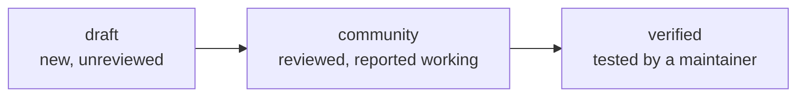

<p align="center">
  
</p>

<h1 align="center">whistle-recipes</h1>

<p align="center">
  <b>Recipes for running apps on an OS they weren't built for.</b><br>
  Windows apps on Linux through Wine, Linux apps on Windows through WSL, for <a href="https://github.com/thisisroot/whistle">Whistle</a>.
</p>

<p align="center">
  
  
  
  <a href="LICENSE"></a>
</p>

<p align="center">
  <a href="#example">Example</a> ·
  <a href="#the-format">The format</a> ·
  <a href="#adding-a-recipe">Adding a recipe</a> ·
  <a href="#how-recipes-reach-users">How recipes reach users</a>
</p>

A recipe says where the installer comes from, which typed steps prepare the
environment, and which programs to add to the menu. With it, this is all a user
needs to type:

```sh
whistle install notepad++
```

Recipes are **data, not scripts**. There is no shell step: a recipe can only use
the actions in the schema, so it's easy to review and can't run arbitrary
commands. The Whistle client re-checks every path and registry key before it
acts on one.

## Example

```yaml
# recipes/org.notepad-plus-plus.NotepadPlusPlus.yaml
schema_version: 1
id: org.notepad-plus-plus.NotepadPlusPlus
app: org.notepad-plus-plus.NotepadPlusPlus
version_range: "8.9"
runtime: wine
requires:
  wine: ">=8.0"
  arch: win64
installer:
  type: download
  url: https://github.com/notepad-plus-plus/notepad-plus-plus/releases/download/v8.9.9/npp.8.9.9.Installer.x64.exe
  sha256: "a18cfb33d616c8eecda0059604d40bdb9d607fbc4ede857c8be6e41986464367"
steps:
  - run_installer: { args: ["/S"] }
launchers:
  - name: Notepad++
    exe: 'C:\Program Files\Notepad++\notepad++.exe'
    mime: [text/plain]
```

## The recipes

| Recipe | Runtime | Status |
| --- | --- | --- |
| [Notepad++](recipes/org.notepad-plus-plus.NotepadPlusPlus.yaml) | wine | **verified**: install, launch and remove tested on Wine 10 |
| [GNOME Builder](recipes/org.gnome.Builder.WSL.yaml) | wsl | community |
| [Microsoft Office 2016](recipes/com.microsoft.Office2016.yaml) | wine | draft: you supply the installer |

## The format

The full definition is [`recipe.schema.json`](src/whistle_recipes/recipe.schema.json).

| Field | Meaning |
| --- | --- |
| `id`, `app` | The recipe's ID, and the catalog app it installs (reverse-DNS, like `org.gimp.GIMP`). |
| `runtime` | `wine`, `proton`, `wsl` or `vm`. |
| `requires` | Minimum runtime version, `win32`/`win64`, RAM and disk. |
| `installer` | Where the installer comes from (see below). |
| `steps` | Typed actions, run in order (see below). |
| `launchers` | The programs to add to the menu, with optional MIME types and categories. Leave it out to use the Start Menu shortcuts the installer creates (Wine and Proton). |
| `health_check` | Which launcher must open a window after install, and how long to wait. |
| `fallback` | What to offer if the health check fails: `vm` or `none`. |

**Installers:**

| Type | Use it for |
| --- | --- |
| `download` | An HTTPS URL on the vendor's own site, plus its SHA-256. |
| `user_supplied` | Licensed software that can't be downloaded freely. The user picks the file, and it must match one of the listed hashes. |
| `package` | A package inside the runtime, such as apt inside WSL. |

**Steps:**

| Step | What it does |
| --- | --- |
| `winetricks` | Install winetricks verbs, like `vcrun2019` or `corefonts`. |
| `dll_override` | Set DLLs to `native`, `builtin`, either order, or `disabled`. |
| `registry` | Set values under `HKCU` or `HKLM`. Strings become `REG_SZ`, integers `REG_DWORD`. |
| `copy` | Copy a file from the installer media to a Windows path in the prefix. |
| `env` | Set environment variables for the launchers. `PATH`, `LD_PRELOAD` and similar are refused. |
| `run_installer` | Run the installer with arguments, such as `/S` for a silent install, and an optional timeout. |

## Adding a recipe

1. Create `recipes/<id>.yaml`. The file name must match `id`, and the app must
   exist in the Whistle catalog.
2. Get the installer's SHA-256 from a source you trust: the vendor's published
   checksums, or GitHub's asset digest. Don't just hash whatever you happened
   to download.
3. Validate it:

   ```sh
   uv sync
   uv run whistle-recipes-validate recipes
   uv run pytest
   ```

4. Try it for real with the Whistle client:

   ```sh
   whistle install <app> --via wine --allow-draft
   ```

5. Open a pull request.

### Review levels



Every new recipe starts as `draft`, and clients only offer drafts with
`--allow-draft`. A maintainer promotes a recipe in
[whistle-server](https://github.com/thisisroot/whistle-server)'s
`seed/recipe-status.json`. Deleting a recipe file retires it.

**Generated recipes.** For the Windows apps nobody has written a recipe for
yet, whistle-server generates one from winget's package data and marks it
`untested`. Those aren't in this repo. A recipe here always wins over a
generated one for the same app, so writing one is the way to fix an app whose
generated recipe doesn't work.

## How recipes reach users

[whistle-server](https://github.com/thisisroot/whistle-server) indexes this repo
every time it rebuilds the catalog, at least once a day. It stores each change as
a new revision, so compatibility reports always refer to the exact steps someone
ran. The current revision goes into the catalog that `whistle update`
downloads.

This repo is also a Python package (`whistle_recipes`) that provides the schema
and the validator. whistle-server uses it to check recipes.

## License

[CC0-1.0](LICENSE). Recipes are facts about how to install software, so anyone can reuse them.
